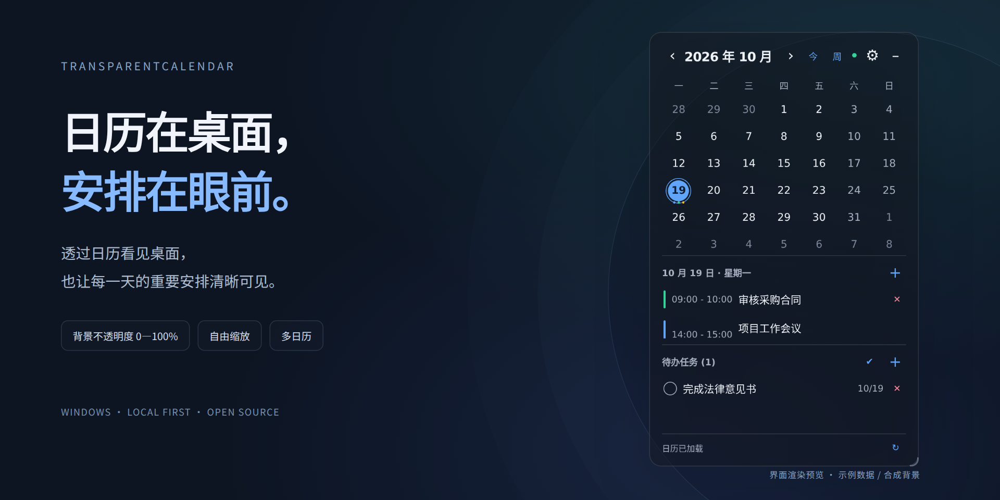
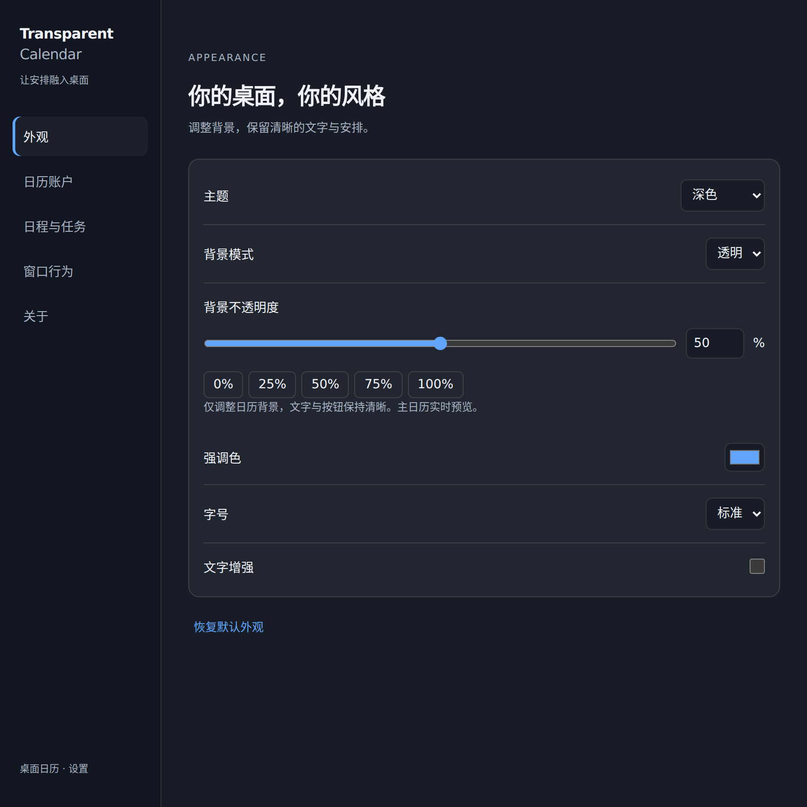
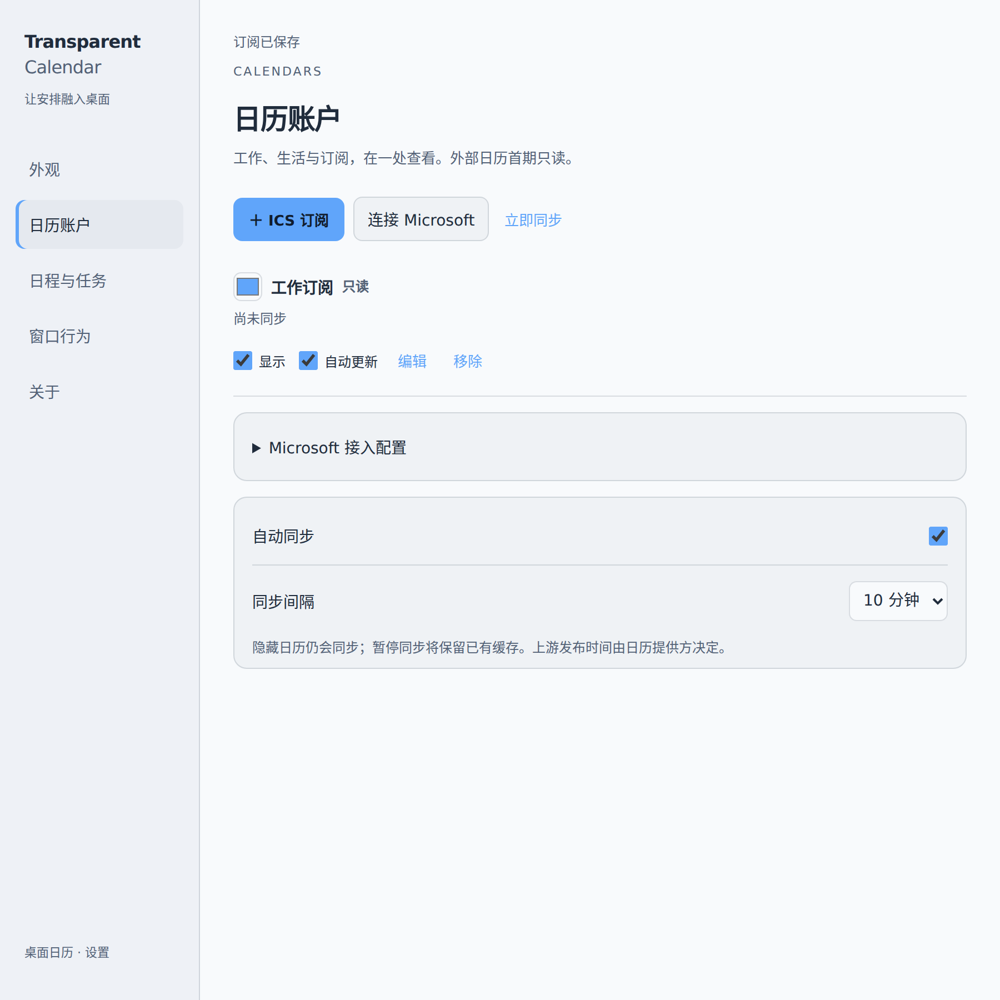

<div align="center">

# TransparentCalendar · 透明日历

**日历在桌面，安排在眼前。**

Windows 透明悬浮日历，让本地安排、Outlook 和 ICS 订阅在一处呈现。

[简体中文](README.md) · [English](README.en.md)


**[下载最新版本](https://github.com/TuSiV/TransparentCalendar/releases/latest)** · [快速开始](#快速开始) · [反馈问题](https://github.com/TuSiV/TransparentCalendar/issues)



<sub>应用界面渲染预览，使用示例数据与合成背景；非 Windows 实机桌面截图。</sub>

</div>

## 桌面留给你，安排交给日历

| 看得清，也透得过 | 大小与布局由你决定 |
| :--- | :--- |
| 背景不透明度 **0%—100%**，文字和按钮保持清晰。 | 拖动四边或四角缩放，宽窗口自动切换为左右布局。 |
| **月／周视图**切换，快速查看当天日程与任务。 | 两种视图分别记住位置与尺寸，重启后恢复。 |
| 支持**深色、浅色、跟随系统**，可调整字号与强调色。 | 本地日程、多个 Outlook 日历及 ICS 订阅同时显示。 |

无需登录，即可管理本地日程与任务。需要工作日历时，再连接外部来源。

## 下载与安装

| 版本 | 适合谁 | 下载 |
| :--- | :--- | :--- |
| **安装版** | 日常长期使用，按向导选择安装位置 | [打开最新发布页，下载 Setup 安装包](https://github.com/TuSiV/TransparentCalendar/releases/latest) |
| **便携版** | 希望免安装直接运行 | [下载 TransparentCalendar.exe](https://github.com/TuSiV/TransparentCalendar/releases/latest/download/TransparentCalendar.exe) |
| **校验文件** | 核对下载文件的 SHA-256 | [SHA256SUMS.txt](https://github.com/TuSiV/TransparentCalendar/releases/latest/download/SHA256SUMS.txt) |

当前提供 **Windows x64** 安装包。关闭或隐藏日历后，可从系统托盘重新打开。

## 快速开始

1. **放到合适的位置。** 拖动顶部空白处移动窗口，拖动边缘调整大小。
2. **添加今天的安排。** 选中日期，点击日程或任务区域的 `+`；点击本地记录可查看详情和编辑。
3. **调成舒服的样子。** 点击齿轮进入独立设置中心，选择主题、字号与背景不透明度。

| 常用操作 | 入口 |
| :--- | :--- |
| 月／周切换、回到今天 | 顶部的「周／月」与「今」 |
| 完成任务、展开已完成任务 | 任务圆圈、任务区域的勾选按钮 |
| 恢复已完成的本地任务 | 展开后，再次点击任务圆圈 |
| 置顶、手动同步、开机启动 | 设置中心或系统托盘菜单 |
| 鼠标穿透后恢复交互 | 托盘关闭穿透，或按 **Ctrl + Alt + C** |

开启鼠标穿透后，**空白区域穿透到桌面，日期、添加按钮、日程、任务、编辑面板和缩放边缘仍可操作**。无需关闭穿透即可切换日期或添加安排。恢复交互快捷键可修改；设置窗口始终可以正常操作。

## 日历接入与操作能力

| 来源 | 查看 | 新增／编辑 | 接入方式 |
| :--- | :---: | :--- | :--- |
| **本地日程与任务** | ✓ | 新增、详情、编辑、删除；任务可完成与恢复 | 直接使用，无需账户 |
| **Outlook / Microsoft 365 日历** | ✓ | 只读，可查看详情及打开原日历链接 | Microsoft 授权，需自有 Client ID |
| **ICS / webcal 订阅** | ✓ | 只读 | 订阅地址＋实际连接测试 |
| **Microsoft To Do** | ✓ | 创建与完成任务；详情只读 | Microsoft 授权，使用默认任务列表 |

多个 Microsoft 账户、账户下的多个日历及多个 ICS 订阅可以同时显示。每个日历均可独立设置颜色、显示状态和更新开关。

Google 原生授权、iCloud CalDAV、外部日历写入和原生毛玻璃尚未提供。需要清楚看见下方桌面内容时，使用透明背景模式。

<details>
<summary><strong>添加 ICS 订阅：无需配置 Microsoft 应用</strong></summary>

1. 从日历提供方获取 **ICS 或 webcal 订阅地址**。
2. 打开 **设置 → 日历账户 → ICS 订阅**。
3. 填写名称、地址与颜色，点击 **测试连接**。
4. 测试成功后添加；未来 90 天内没有日程的有效订阅也可添加。

订阅地址默认遮罩显示。移除订阅会清理该来源缓存，保留本地记录。

</details>

<details>
<summary><strong>连接 Outlook / Microsoft 365：Client ID 与授权说明</strong></summary>

项目目前未配置内置 Azure 应用身份，需要使用自己的公共客户端 Client ID；应用须允许设备代码登录，并符合所在租户的授权策略。

1. 在 **设置 → 日历账户 → Microsoft 接入配置** 中填写 Client ID。
2. 点击 **连接 Microsoft**，在 Microsoft 授权页面输入设备代码。
3. 授权后选择要显示的日历；连接另一个账户时重复该流程。
4. 在已连接账户下点击 **选择日历**，继续添加该账户的其他日历。

请求权限包括 `User.Read`、`Calendars.Read`、`Tasks.ReadWrite` 和 `offline_access`。任务权限用于 Microsoft To Do。更换 Client ID 前，先断开原 Microsoft 账户。

Microsoft To Do 当前使用首个已登录账户的默认任务列表；可在 **日程与任务** 中选择新任务保存到本地或 To Do。

</details>

<details>
<summary><strong>设置中心预览</strong></summary>

外观、日历账户、日程与任务、窗口行为、关于，分别管理。





以上均为界面渲染预览，使用示例数据。

</details>

## 同步、离线与数据

| 设置或状态 | 实际行为 |
| :--- | :--- |
| **隐藏日历** | 主界面不显示，仍按设置更新 |
| **暂停来源更新** | 保留缓存，停止获取该来源的新数据 |
| **关闭自动同步** | 读取已有范围缓存；手动刷新可更新未暂停来源 |
| **部分来源失败** | 其他来源继续；失败来源保留相同时间范围的缓存 |
| **自动同步间隔** | 可选 5、10、15、30、60 分钟 |

缓存按来源和时间范围保存；离线时，未曾成功获取的时间范围可能没有内容。ICS 实际更新速度还取决于提供方。

本地记录、设置、日历缓存和 Microsoft 登录缓存保存在应用用户数据目录。**ICS 地址可能包含访问密钥**，分享配置文件前请移除地址。来源错误提示不会回显订阅地址或令牌。

升级会迁移旧版 ICS 与外观配置，保留本地日程和任务。旧版整体透明度会换算为背景不透明度。

## 开发

基于 Electron、HTML / CSS / JavaScript、Microsoft Graph 和 ical.js。

```sh
npm ci
npm start
```

<details>
<summary><strong>测试与 Windows 打包</strong></summary>

```sh
npm test
npm run test:electron
npm run dist -- --publish never
```

`test:electron` 检查真实 Electron 窗口、preload IPC、数据持久化与 Windows 开机启动。Windows CI 还会构建安装版和便携版。模拟 API 的浏览器界面检查不替代真实 Microsoft 账户授权或 Windows 桌面合成、DPI 的实机验收。

发布流程位于 [release.yml](.github/workflows/release.yml)，验证流程位于 [validate.yml](.github/workflows/validate.yml)。

</details>

---

[MIT License](LICENSE) · [TuSiV](https://github.com/TuSiV) · [发布记录](https://github.com/TuSiV/TransparentCalendar/releases)
